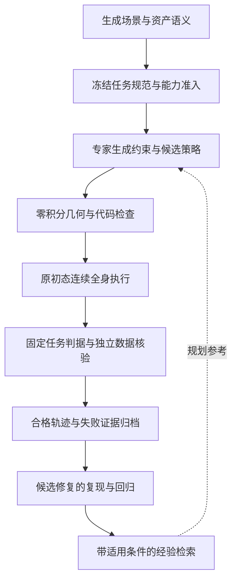

# 高质量全身专家轨迹的论文经验与实现方案

2026年10月26日。适用对象为自有生成场景中的 G1 全身抓取、持物行走与放置。目标是提高合格数据产量、有效多样性和单位资源产出，同时保持原生动力学与独立验收。

本轮阅读了六篇指定论文的方法、实验、局限及关键实现附录，并沿 AGP 的引用补读 ASPIRE。优先采用的组合是：**可定位的执行证据、带适用条件的经验库、对象坐标系中的分阶段求解，以及冻结标准下的验证与晋升。** 这些是后续实现方案；本次没有运行新轨迹、训练模型或改变现有控制器。

## 论文方法与适用边界

### ASPIRE

阅读版本为 `2607.00272v2`，2026年10月20日修订。它逐原语保存 API 输入输出、状态和前后关键帧；修复经验包含失败特征、适用条件和代码示意，经过独立 verifier 复现后入库。调试与评估 seed 分离。其局限包括经验只在入库时检查一次、可能过期，以及搜索成本高。附录还显示不同独立调试 run 可产生明显不同的结果。[方法 §2、局限 §5、附录 E.10](https://arxiv.org/html/2607.00272v2#S2)

这比保存完整聊天更适合作为我们的经验组织方式。它的跨本体迁移仍需在目标机器人上重新调试，不能当作控制代码直接部署；按已经看到的评估低分选择任务返工，也不能替代真正封存的独立测试。[迁移 §3.6、返工评估 §3.8](https://arxiv.org/html/2607.00272v2#S3.SS6)

### Embodied Turing Machines

阅读版本为 `2610.12369v1`，2026年10月预印本。它将环境、机器人和任务状态显式化，通过共享库组合任务；候选修改先过数值流程和 IK/碰撞检查，再执行验证。改进基于相同布局比较，旧调用路径通过默认关闭的新参数保护。这个兼容性只覆盖已测 fixture，不能保证所有真实动力学情况。附录的部分对照曲线为示意，分支加速也增加总计算量。[方法 §3、讨论 §5、附录 A.2/B](https://arxiv.org/html/2610.12369v1#S3)

我们可采用分层代码和状态来源记录；其运行时纯代码及视觉测量设定与我们使用模拟器状态、固定 SONIC 神经控制器的设定不同。论文讨论了数据引擎用途，不能据此认定我们的数据已有训练收益。

### Agent as Policy

阅读版本为 `2609.12541v3`。它将智能体与独立机器人运行时通过文件请求桥接，记录实测状态、目标误差和视觉证据。经验保存程序、标定及修正方法，但每轮重新观测对象位置。附录指出：重复经验实验是有顺序的少量试验，仍需无经验对照；部分成本均值只统计成功试验。失败分析中也出现了智能体声称完成、人工复核不认可的情况。[方法 §3、附录 B.3/D.2/D.3/F.5](https://arxiv.org/html/2609.12541v3#S3)

对我们最直接的启发是：控制命令完成、智能体自述完成、物理任务完成必须分别记录。手内接触或支撑改变后，应重新检查，而不能沿用旧的成功判断。

### GenSim2

阅读版本为 `2410.03645v1`，CoRL 2024。它把求解器分成接触约束、操作姿态、接近和后续运动；使用对象关键点及对象坐标系，并区分程序能执行与任务能完成。人工关键点标注和筛选仍然存在；困难任务还使用了较小随机化幅度。其数据价值通过训练与物体实例划分验证，不能用生成数量替代。[方法 §3、附录 A.3/A.4/A.5/B.4](https://arxiv.org/html/2410.03645v1#S3)

我们可先让专家输出可核验的抓取区域、坐标系和阶段约束，再生成参考代码。其 6-DOF 台面操作经验不能直接充当人形平衡与原生多指抓持的验收证据。

### RoboGen

阅读版本为 `2311.01455v3`，ICML 2024。它从机器人能力和资产可供性提出任务，检查资产、尺寸与空间关系，并为子任务选择规划、轨迹优化或学习。需要注意：抓取使用吸盘简化；长任务学习会选择子任务较优结束状态继续下一段；部分指标衡量的是成功学到技能的 run 比例。论文承认大规模技能验证仍困难。[§3、§4.2、§5、附录 A/B.3](https://arxiv.org/html/2311.01455v3#S3)

可借鉴其资产与任务准入，但不引入吸附、隐式附着或拼接子任务状态来替代我们要求的原初始化连续全身执行。

### Voyager

阅读版本为 `2305.16291v2`。它以可执行代码保存技能，用任务描述和失败反馈检索相关技能，再结合环境、解释器和评议反馈修正程序。消融支持技能库与反馈的作用，但评议器也会误判，课程也会提出不存在的任务；Minecraft 原语不能证明原生机器人接触可行。[§2、§3.4、§4、附录 A.4/A.5](https://arxiv.org/html/2305.16291v2#S2)

我们可采用“检索代码与经验”的组织方式。最终成功仍由固定物理判据和独立审计决定；论文的固定尝试次数不是本项目的科学退出条件。

### Eureka

阅读版本为 `2310.12931v2`，ICLR 2024。它把待优化的奖励与独立 fitness 区分，向模型提供各分量随训练变化的反馈，而不仅是一个总分；再比较多个候选并保留较优者。它依赖可定义的 fitness，并消耗多次 RL 训练；最终实验也有明确的训练 run 和 checkpoint 统计口径。[§2、§3、§4.2、附录 H](https://arxiv.org/html/2310.12931v2#S2)

我们可将“分量反馈”用于轨迹阶段诊断。当前优化对象仍是参考策略代码，不因此启动奖励搜索、训练，或让专家修改最终判定。

## 对照现有系统的具体经验

本地证据入口为[本轮最终核验](/data/wsj/main/scene_runs/codex_trellis_v2/embodied_generated_grasp_execution_20261026_v1/FINAL_REVIEW.json)、[数据清单](/data/wsj/main/scene_runs/codex_trellis_v2/embodied_generated_grasp_execution_20261026_v1/DATASET_MANIFEST.json)及各 trial 的绑定报告。当前合格产量仍为两个布局中的两条杯子轨迹，瓶和书没有完整成功。

| 本地证据 | 已知事实 | 后续应形成的能力 |
| --- | --- | --- |
| cup 基线放置超时，v003 完成放置但末窗拒绝，v004 两布局全核验通过 | 空中夹持反馈及完整稳定观测窗口有该范围内的实测支持 | 将方法及适用资产、控制条件、原判据一起保存；不能直接升级为所有物体通用技能 |
| bottle v009 → v010 | 保留已获预载后，S02 从提拉滑移推进到悬停及约0.53米持物行走；整条任务仍失败 | 单独记录阶段改善；提拉修复不能自动视为搬运到放置的保持修复 |
| bottle S02 v010 place 前后 | 接触先后丢失，实际滑移超过原门限；参考变化与失接触有时序关联 | 输出首次失接触、各指参考与实测响应、支撑转换时刻，继续区分观察与因果假设 |
| bottle S03 v010 | 同策略在 close 超时 | 保留同策略配对负例；不能只复用 S02 的局部成功结论 |
| flat book 当前模型的有限抓姿被拒绝 | 存在接近面、台面净空、原生穿入或承载问题 | 在生成下一批任务时检查可接近面和抓取方式；不能把有限失败写成书本全局不可抓 |
| 旧16MiB书模型的连续诊断 | 状态回放误差为零，仍有实际 CONTACTFULL | 数值告警独立于状态一致性验收；数值无效记录不得入正例集 |
| 字段 `up` 与对象语义轴 | 部分 trace 的 `up` 表示机器人姿态；书封面法向又不同于杯瓶 local Z | 状态必须标明实体、轴、坐标系和单位，避免不同物理量共用模糊字段 |

瓶子 `v011` 只是未实测草案。将预载保护延伸到后续空中阶段是待检验假设；文献阅读不构成它已修复问题的证据。

## 推荐的专家接口与执行流程

保留当前离线专家改写参考代码、SONIC29 与原生14手指 PD 执行的结构。先改善专家看见的证据与可复用接口，再讨论改变控制体系。

### 明确任务规范与阶段交接

任务规范应固定机器人与控制器身份、模型和资产哈希、物性假设、源与目标支撑区域、允许接触角色、语义轴、观测可用性和最终判据。实际状态与规划参考分别保存；motor reference 不能充当实际关节姿态或接触证据。

资产尺寸、质量和初态可以在新任务准入前声明；失败后改变这些条件必须建立新任务身份，不能仍称原任务的策略修复。姿态字段要写明实体、参考系和四元数顺序，例如将机器人朝上量与物体语义轴朝上量分开。

| 阶段 | 必须观察的交接信息 |
| --- | --- |
| 准备与接近 | 对象坐标系、参考模式、实际到达误差、真实家具边界与通路净空 |
| 合指 | 各指参考与实测姿态、实际接触角色、对向接触及原有限幅 |
| 提拉测试 | 对象离桌、实际承载、相对滑移和抓持状态；静态容量估计只作诊断 |
| 抬升与悬停 | 连续保持时长、原生接触、物体运动、机器人平衡及实际高度 |
| 持物行走 | 脚步周期、持物位移、接触保持与参考模式转换；不能在进入新阶段后丢失已有约束 |
| 放置与释放 | 手与桌的支撑转换、触桌锁存、物体姿态、实际脱手和收手后的稳定 |

稳定条件以物理时间和完整子步窗口定义，并核对50Hz参考与200Hz积分的边界。辅助质量指标可以报告平滑度、净空和控制余量，但不能悄悄替换已冻结的任务判定。

### 给专家提供短而可追溯的反馈

每次失败先提供摘要，再允许按需读取原证据。摘要包括：失败类别、首次违规阶段与时间、最小余量、前后实际状态、命令参考、接触与支撑变化，以及源码/模型/trace 的绑定。几何推断、观察到的时序和待验证原因分别标记。

失败至少区分服务中断、代码/API问题、场景或模型准入、数值失效、抓姿与通路、承载、搬运保持、放置交接、最终稳定、导出与来源问题。服务容量失败不算一次物理策略失败；已发生的调用与积分成本仍要记录，未知用量不能写成零。

目前 broker 已支持状态、试验和实际状态检查，但实际 rollout 仍串行。未来候选分支的并行调度属于新增能力，不能因为论文采用并行就认定现有系统已支持。

当前 `protocol.py`、`prepare_v3.py` 与 `common.py` 还绑定旧轮根、历史成本和额度。后续应另建版本，以明确的运行上下文传入这些身份；不能仅换输出目录就将冻结旧协议当成通用运行器使用。

## 经验库的第一版结构

先用结构化文件及明确标签检索即可。记录应包含失败特征、适用前提、修复意图、代码绑定、复现证据、反例、依赖版本和失效条件。检索先按机器人、控制方式、接触角色、资产/几何及阶段硬筛选，再考虑语义相似度。

经验分三类：

- **范围内已验证**：有完整任务与数据核验支持，仍受资产、控制器和已测条件限制。
- **局部阶段改善**：证明一个阶段进步，但整条任务失败，只用于规划与查因。
- **假设或负例**：可帮助排除错误做法或提出候选，不能作为成功技能自动部署。

本轮已整理可追溯的[经验候选记录](/data/wsj/main/scene_runs/literature/expert_trajectory_review_20261026_v1/EXPERIENCE_CANDIDATES.json)。这是经验库的输入材料，检索器与自动晋升尚未实现。

依赖模型、控制器、公共库或物性变化后，相应经验应转为待复验。运行时的对象位置和抓持关系必须重新观测，不能把旧 trial 的绝对位置当作当前事实。

## 晋升和收益验证

候选策略与当前保留策略在相同验证 case、初始化和预算下比较。数值有效、原任务门、姿态、独立审计、连续复验及数据核验是硬条件；局部进度分数不能补偿硬门失败。成功后再比较合格产量、实际多样性与成本，不只选择最高的一次结果。

调试集用于定位错误，选择验证集用于挑选策略和返工任务，最终隔离测试在冻结策略后使用。若看到测试分数后再修改程序，应明确为反馈开发，不再把同批结果当作首次独立测试。当前两布局共享杯资产和工位模板，不能靠随机分帧或分 episode 获得可信隔离。

建议分两步证明收益：

1. 在相同总预算下，对照固定专家、带反馈但不读持久经验的专家、带反馈与经验检索的专家。比较独立任务上的合格产量、失败成本、模型用量、总时间及主控干预；全部尝试都计入成本。多次独立开发 run 可揭示搜索运气，积分子步不能当独立样本。
2. 再冻结学生策略的观测和动作定义，比较等量、不同质量或多样性的数据是否提高隔离任务表现。现有全43控制归档是动力学复验依据，不自动等于学生应预测的动作；专家意图、参考量、SONIC输出和实际执行器控制必须区分。

## 实现优先顺序与验收

| 优先项 | 交付 | 最小验收证据 |
| --- | --- | --- |
| P0 执行反馈 | 明确字段语义、阶段状态和失败证据索引 | 现存杯末窗失败、瓶提拉/放置失败、书数值失效能被正确区分，并指回原记录 |
| P0 经验检索 | 有适用条件与三类状态的记录、按依赖筛选的检索 | 瓶局部改善与未测v011不能作为完整成功技能；旧位置不能直接重用 |
| P1 分阶段参考接口 | 抓取区域、接近姿态、承载与支撑交接分开表达 | 私有零积分检查和正式原初态试验各有明确结果；保持原控制与验收 |
| P1 晋升与恢复 | 旧策略保留、候选冻结、回归和服务中断续接 | 能在不重复试验、不改旧账的条件下恢复；失败候选不覆盖保留版本 |
| P2 收益评估 | 来源隔离的任务组、预算对照、后续训练验证 | 报告合格产量/总成本、有效多样性和干预；不以版本数或单次成功证明自进化 |

本次新增物理积分为0，累计仍为239138。旧实验根、绑定源码及生成器原有改动保持原状。下一次实施或动态验证应另建版本和有界轮次，不延用已结束的实验窗口。

## 阅读记录

七篇均取得版本固定的全文；阅读覆盖上文所引方法、实验、局限和关键附录，不声称逐字审阅所有提示词、每张图或运行其代码。全文缓存、章节哈希、阅读范围与核验记录位于[本轮阅读归档](/data/wsj/main/scene_runs/literature/expert_trajectory_review_20261026_v1/READING_LOG.json)。本文件中的实现顺序和项目适配方案是结合本地证据提出的设计，尚待工程实现与实测。
